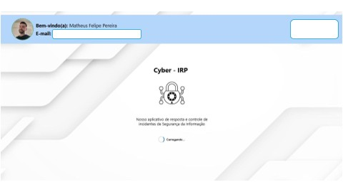
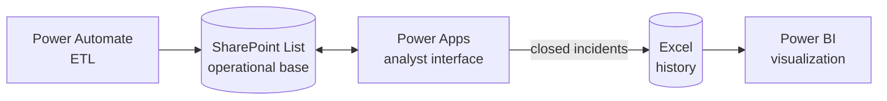
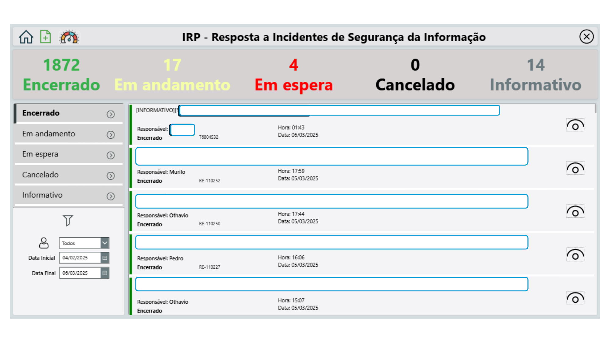
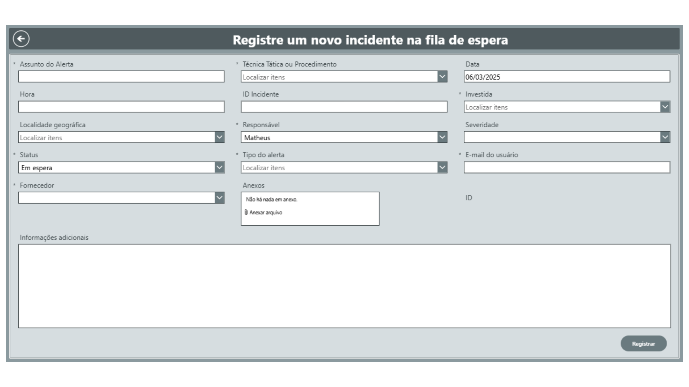
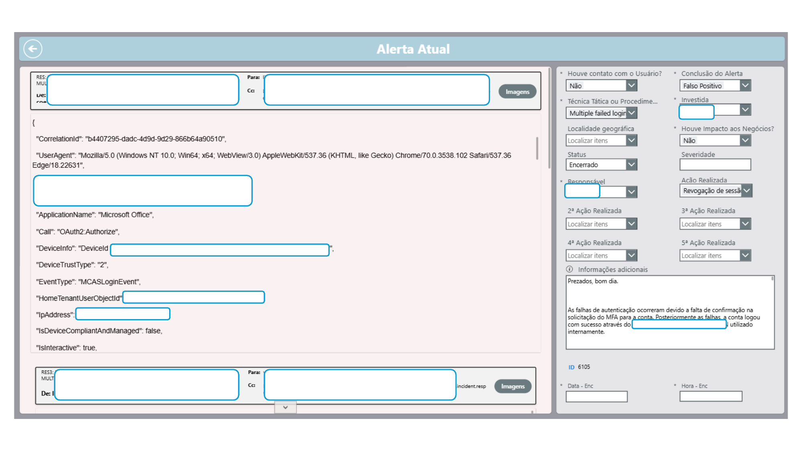
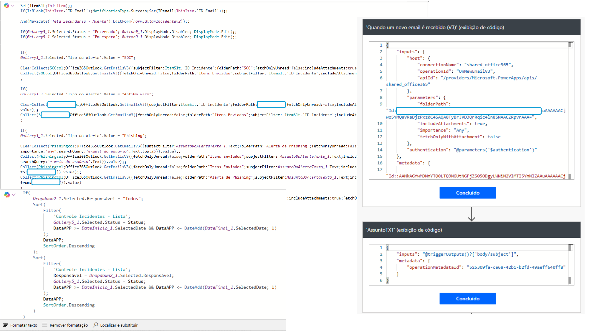

  

  
  
  
  
  
   
  
  
  

## 🛡️ Overview

An application for **Information Security incident management** (IRP — Incident Response), built end-to-end on the **Microsoft Power Platform**.

## 🏗️ How it works

| Layer | Technology | Role |
|---|---|---|
| ⚙️ Extraction & transformation | **Power Automate** (PowerFX) | Captures and prepares incident data |
| 🗄️ Storage | **SharePoint List** + **Excel** | Operational base + historical repository |
| 📱 Interface | **Power Apps** (PowerFX) | Where the team registers and manages incidents |
| 📊 Visualization | **Power BI** | Indicators — see [CyberSecurity Incidents Dashboard](https://github.com/MatheusFelipePereira/cybersecurity-incidents-dashboard) |

## 🔄 Incident lifecycle

1. **Power Automate** detects, extracts, transforms and loads (ETL) cybersecurity incidents into a **SharePoint List** — the operational base.
2. Analysts open the **Power Apps** app to validate each incident and complete it after analysis and response (e.g. *false positive*, *spam*, *real incident*).
3. The incident is **closed**, and consolidated data is stored in an **Excel** historical base.
4. That base feeds **Power BI** — stage two of the project: the [CyberSecurity Incidents Dashboard](https://github.com/MatheusFelipePereira/cybersecurity-incidents-dashboard).

## 🚀 Results

| | |
|---|---|
| ⏱️ **100+ hours** | of analysts' manual work eliminated |
| ⚡ **+30%** | team operational capacity for analysis, response and reporting to leadership |

## 📸 App gallery

<table>
  <tr>
    <td width="50%" align="center"> <b>Welcome / loading screen</b></td>
    <td width="50%" align="center"> <b>App screen</b></td>
  </tr>
  <tr>
    <td width="50%" align="center"> <b>Register a new incident</b> in the queue</td>
    <td width="50%" align="center"> <b>App screen</b></td>
  </tr>
  <tr>
    <td width="50%" align="center"> <b>App screen</b></td>
    <td width="50%" align="center"> <b>Power BI output</b></td>
  </tr>
</table>

## 👥 Team

Built with César at **Votorantim Cimentos**, in a **Scrumban** flow.

---

🔒 Corporate project: incident data is confidential, so this repository documents the solution only.  
👤 Part of <a href="https://github.com/MatheusFelipePereira">Matheus Felipe Pereira's portfolio</a> · <a href="https://www.linkedin.com/in/matheus-felipe-p/">LinkedIn</a>
